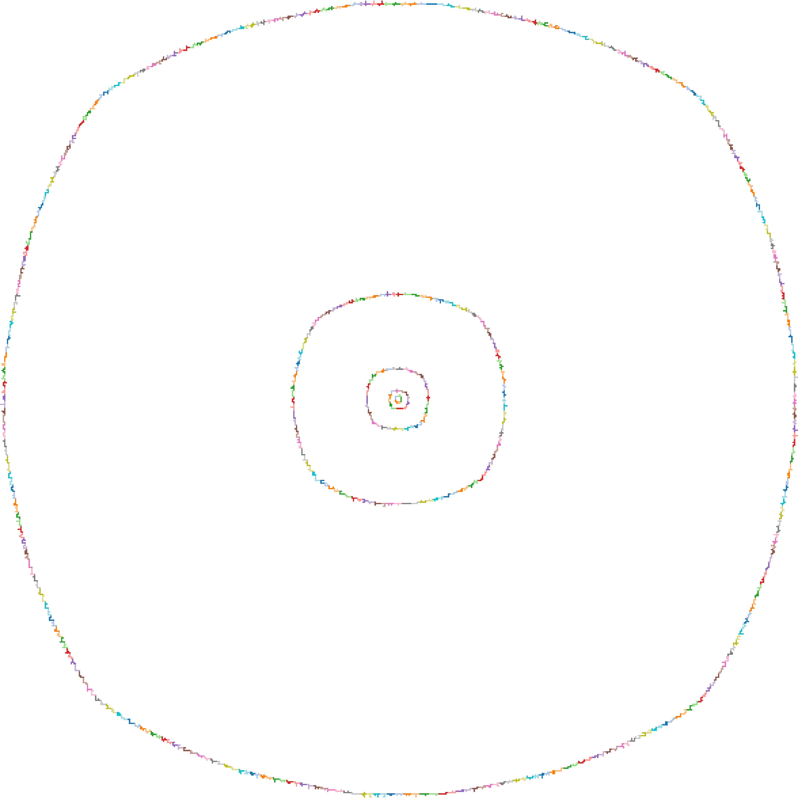

# Optimal Polyomino Fences

The $n$-omino fence problem asks how many tiles can be surrounded by placing every n-omino exactly once in the grid. This is the companion repository for our paper on the problem. 


## (3) Pentomino fences

### (3.2) Dynamic programming with fixed Order

The implementation `Pentomino-Fence/Fixed-Order/pentomino-minmax.jl` closely follows the pseudocode described in Section 2.2.1. The results for all possible orders are available in `Pentomino-Fence/Fixed-Order/data/order.tar.gz`. It was produced in 48 hours with the following command:
```bash
awk 'BEGIN{for(i=2;i<=12;i++) for(j=2;j<=12;j++) if(i<j) print i,j}' | rush 'julia pentomino-minmax.jl {1} {2}'
```

It uses the [rush](https://github.com/shenwei356/rush) tool to run the search in parallel.

### (3.3) Dynamic programming with unrestricted order

The implementation is either available as a Jupyter notebook (`Pentomino-Fence/Unrestricted-Order/pentomino-fence.ipynb`) or normal file (`Pentomino-Fence/Unrestricted-Order/pentomino-fence.jl`). It follows the explanations in Sections 2.2.1 and 2.3.

As mentioned in the paper, proving optimality for the pentomino fence takes just a few minutes on a laptop (and just 15 minutes on a Raspberry Pi 4 with 4GB of memory).

In `Pentomino-Fence/Unrestricted-Order/data/shoelace-proof.pdf`, we also have written up an elementary proof of the Shoelace formula for interested readers.

## (4) Hexomino fences

The Python code implements the method as described in Section 4.2, to
prove that 1597 is the optimal area for the hexomino
fence. Additionally, as mentioned in Section 4.3, it can be used to
identify all solutions. All programs are meant to be run with
[pypy3](https://pypy.org/) inside the directory `Hexomino-Fence`.

* `best_fence_step0.py <n> [--progress] [--verbose]`
is imported by the other steps and generates all $n$-ominoes and their
reference vectors, together with the corrections (negative penalties), the
rotation, and the parity. With `--progress`, a progress counter is
shown. With `--verbose`, the pieces are printed. This python program can also
be run directly with the `--verbose` option, to print all pieces.

* Step 1 (Branch-and-Bound):

  ```bash
  pypy3 best-fence-step1.py <n> <goal> [--cache] [--progress] [--check]
  ```

  It enumerates all sequences of reference vector classes whose upper bound is at least `<goal>`. Internally, the program subtracts 0.001 from the threshold to guard against rounding errors. The optional flags are all off by default:
  * `--cache` stores the precomputed vector lists and the bounds for the not yet processed pieces in a pickle file in the temporary directory of the system (`step-1-<n>.pkl`) and reloads them in later runs with the same `<n>`.
  * `--progress` shows progress counters.
  * `--check` is a slow self-test that compares the incremental bound at every node of the search tree with the classical computation.

  For the optimality proof, use `pypy3 best-fence-step1.py 6 1598`. The program needs about 2 hours and produces 7128 candidates. For all optimal solutions use `6 1597`, which produces 21,283 candidate vector sets after about running slightly longer. The results are written to the file `best_fence_candidate_solutions_step_1_n6t1597.py` (about 15 MBytes).
* Step 2, `pypy3 best-fence-step2.py 6 1597`, takes the rotation and the parity into account and reduces the candidates of Step 1 instantly to the following 10 vector sets:

  ```
  Vector set #1: (((0.0, 5.0), 2), ((0.0, 6.0), 1), ((1.0, 5.0), 3), ((0.0, 4.0), 3), ((1.0, 3.0), 4), ((1.0, 4.0), 11), ((2.0, 3.0), 1), ((2.0, 4.0), 5), ((2.5, 2.5), 4), ((3.0, 3.0), 1))
  Vector set #2: (((0.0, 5.0), 2), ((0.0, 6.0), 1), ((1.0, 5.0), 3), ((0.0, 4.0), 3), ((1.0, 3.0), 3), ((1.0, 4.0), 11), ((1.5, 2.5), 1), ((2.0, 3.0), 3), ((2.0, 4.0), 5), ((2.5, 2.5), 2), ((2.5, 3.5), 1))
  Vector set #3: (((0.0, 5.0), 2), ((0.0, 6.0), 1), ((1.0, 5.0), 3), ((0.0, 4.0), 5), ((1.0, 3.0), 4), ((1.0, 4.0), 10), ((2.0, 3.0), 2), ((2.0, 4.0), 4), ((2.5, 2.5), 2), ((2.5, 3.5), 2))
  Vector set #4: (((0.0, 5.0), 2), ((0.0, 6.0), 1), ((1.0, 5.0), 3), ((0.0, 4.0), 3), ((1.0, 3.0), 4), ((1.0, 4.0), 11), ((2.0, 3.0), 4), ((2.0, 4.0), 3), ((2.5, 2.5), 1), ((2.5, 3.5), 3))
  Vector set #5: (((0.0, 5.0), 2), ((0.0, 6.0), 1), ((1.0, 5.0), 3), ((0.0, 4.0), 3), ((1.0, 3.0), 3), ((1.0, 4.0), 11), ((1.5, 2.5), 1), ((2.0, 3.0), 2), ((2.0, 4.0), 6), ((2.5, 2.5), 3))
  Vector set #6: (((0.0, 5.0), 2), ((0.0, 6.0), 1), ((1.0, 5.0), 3), ((0.0, 4.0), 5), ((1.0, 3.0), 4), ((1.0, 4.0), 10), ((2.0, 3.0), 1), ((2.0, 4.0), 5), ((2.5, 2.5), 3), ((2.5, 3.5), 1))
  Vector set #7: (((0.0, 5.0), 2), ((0.0, 6.0), 1), ((1.0, 5.0), 3), ((0.0, 4.0), 5), ((1.0, 3.0), 4), ((1.0, 4.0), 10), ((2.0, 4.0), 6), ((2.5, 2.5), 4))
  Vector set #8: (((0.0, 5.0), 2), ((0.0, 6.0), 1), ((1.0, 5.0), 3), ((0.0, 4.0), 3), ((1.0, 3.0), 4), ((1.0, 4.0), 11), ((2.0, 3.0), 3), ((2.0, 4.0), 4), ((2.5, 2.5), 2), ((2.5, 3.5), 2))
  Vector set #9: (((0.0, 5.0), 2), ((0.0, 6.0), 1), ((1.0, 5.0), 3), ((0.0, 4.0), 3), ((1.0, 3.0), 4), ((1.0, 4.0), 11), ((2.0, 3.0), 2), ((2.0, 4.0), 5), ((2.5, 2.5), 3), ((2.5, 3.5), 1))
  Vector set #10: (((0.0, 5.0), 2), ((0.0, 6.0), 1), ((1.0, 5.0), 3), ((0.0, 4.0), 3), ((1.0, 3.0), 4), ((1.0, 4.0), 11), ((2.0, 3.0), 1), ((2.0, 4.0), 6), ((2.5, 2.5), 4))
  ```
  The results are written to the file `best_fence_candidate_solutions_step_2_n6t1597.py`. It contains a Python list `RESULT` with one entry per vector set, in the same order as above. Each entry is a pair consisting of the multiset (vector class, multiplicity) and the penalty value computed by Step 2.

* Step 3: `pypy3 best-fence-step3.py 6 1597` runs the dynamic program
  on every vector set of the Step 2 file and computes the best
  attainable area of each (no solution reconstruction). It shows that
  only set #10 can reach enclosed area at least 1597. The feasible vector sets are written to `best_fence_candidate_solutions_step_3_n6t1597.py`: a Python list `RESULT` with one dictionary per feasible set, containing `set_number` (as in the list above), `vectors`, `neg_penalty`, `enclosed_area`. This program runs for about a day, and requires about 160 GBytes of main memory.

* Step 4: solution reconstruction on the feasible vector sets of the
  Step 3 file. By default it processes all sets. (For n=6, there is
  only one set.)

  ```bash
  pypy3 best-fence-step4.py [--only SET_NUMBER] [--storage-fileprefix DIRECTORY/xxx] [--compress] <n> <goal>
  ```

  * The program first runs a variation of the dynamic-programming
    algorithm of Step 3, making sure that equal solutions are not
    counted multiple times. Along the way, the program counts the
    different optimal reference polygons.
	In a second phase, the program goes through the tables again, in
    reverse order, and constructs all optimal reference polygons:
    `pypy3 best-fence-step4.py 6 1597` produces
    244 reference vector solutions; they are written to the file
    `all-reference-polygons-6t1597.txt` (which is now contained in the directory `Hexomino-Fence/data`).
  * `--only SET_NUMBER` selects a single feasible vector set instead.
  * With the option `--storage-fileprefix DIRECTORY/xxx`, the tables are
    stored to text files on disk and cleared from memory, to a place that is
    indicated in the parameter `DIRECTORY/xxx`. The files need about 50 GBytes of storage.
	Optionally the files are compressed, and then the files need about
    10 GBytes of storage.
	There is no runtime penalty
    for compression: What is spent on compressing is saved when
    reading the files from disk.
	Even when using this
    intermediate storage facility, the memory usage peaks around 300 GBytes of
    main memory. The program runs for about a day.
	The files are not deleted by the program when it finishes. This
    has to be done by hand.

* Step 4b: `pypy3 best-fence-step4b-count-collinear-orders.py all-reference-polygons-6t1597.txt` counts the orders in which collinear axis-parallel pieces can be permuted. The 244 reference polygons give 500 vector sequences.

* Each of those vector sequences corresponds to $2! \cdot 3! \cdot 3! \cdot 4! \cdot 5! \cdot 6! \cdot 11! \cdot 2^{10} \approx 6.1 \cdot 10^{18}$ different fence solutions.

Running `python3 utils/reconstruct-sol.py data/all-reference-polygons-6t1597.txt` (within the directory `Hexomino-Fence/`) reconstructs 5 (or `n` if `--limit n` is passed) concrete fences for each of the reference polygons in `all-reference-polygons-6t1597.txt` as ASCII art. Note that this reconstruction mechanism is meant for a quick visualization, so we just get a small `n` of the $6.1 \cdot 10^{18}$ possible fence solutions of each reference polygon (and specifically the ones that the ILP solver HiGHS finds first).

### (4.*) Applying the same workflow to pentominoes

Running `pypy3 best-fence-step1.py 5 129`, and then
`pypy3 best-fence-step2.py 5 129`,
the program eliminates all possibilities in a few seconds, establishing optimality of the pentomino fence of area 128.

However, when starting with `pypy3 best-fence-step1.py 5 128` to
construct the optimum solutions, the subsequent Step 2, `pypy3 best-fence-step2.py 5 128`, fails because the program cannot exclude some "weird" usages of
pieces that it cannot handle. (Details are explained in the source file.)


With a hand-made file `best_fence_candidate_solutions_step_3_n5t128.py`
Step 4 recovers the 10 reference polygons that were found by dynamic
programming, see Section (3)


## (5) Heptomino and octomino fences

### (5.1) Lower bound using pruned dynamic programming

In `Hepto-Oktomino-Fence/dynamic-programming-with-pruning.py` we have the same dynamic programming approach as in the `Hexomino-Fence/`, but now allow for heuristic pruning. It finds a heptomino fence with area $19\,733$ in one hour and an octomino fence with area $279\,134$ in seven hours. They are available as `Hepto-Oktomino-Fence/data/hept-19733-19733.csv` and `Hepto-Oktomino-Fence/data/oct-279134-279135.csv`, where the first number denotes the area and the second number denotes the total number of enclosed tiles.

Here are also the solutions together with the an optimal tetromino, pentomino and hexomino fence:




### (5.2) Upper bounds with Branch-and-Bound

As mentioned, we just reuse `Hexomino-Fence/best-fence-step1.py`. With the helper script `Hepto-Oktomino-Fence/data/search-bound.sh` one can also automatically find the smallest upper bound that is proven by step 1 in a certain time limit.

## (6) Larger Fences

### (6.1) Fmax + Dmax upper bound

`Larger-Fences/upper-bounds.py` derives the quick upper bound as described in the paper. Due to memory limitations, we only ran it up to $n = 15$. The code also includes some further methods which are omitted by the paper, since they did not significantly improve the bounds for $n \geq 9$.

### (6.2) Heuristic Solver

The greedy solver is implemented in `Larger-Fences/best-fence-greedy.py`. Its solution can be visualized with `Larger-Fences/data/plot-path.py`; we have already included images up to $n = 15$ as `Larger-Fences/data/fence-{n}.png`.

### (6.3) The limit shape

After compiling our C implementation (run `gcc -O2 -Wall -Wextra -o polyomino-blocks polyomino-blocks.c` in `Larger-Fences/`), you can sample the longest reference vectors of uniform random $n$-omino with `./polyomino-blocks n id` (replace `n` with your value and `id` with any positive integer). It will continuously generate new $n$-ominoes, and write down their longest reference vector (or all of them in case of a tie) to `data/vector-data-{id}.csv`.

Using our 13.5 million samples in `Larger-Fences/data/refvec-500-13500K-samples.tgz` as input, you can reproduce the histogram (Figure 29) with the command `python angle_histogram.py -L 225 --max-vec 13500000 --fg-scale 0.67`. Additionally, with the command `python chain_plot.py --vec-scale 0.65 --vec-shift -0.0007 -k 800 --max-vec 13500000 --rays 0.93 1.03` you can reproduce the chain (Figure 30) and deviation plot (Figure 31).

## (7) Three-dimensional walls

### (7.1) Pentacubes

`Pentocube-Wall/dlx_solver.py` generates pentacube placements, encodes them as an exact-cover instance, and solves it with SSXCC, Donald Knuth's dancing-links solver. The solver will write the solver instance and solution to `output/solfound.dlx`, and the piece coordinates to `output/solfound.json`.

### (7.2) Hexacubes and heptacubes

The greedy solver for hexocubes is implemented in
`Hexo-Heptocube-Wall/hexo_greedy` and for heptocubes in `Hexo-Heptocube-Wall/hepto_greedy`.
The produced solution is written in the `Hexo-Heptocube-Wall/output` folder.

## (A) Alternative proof of hexomino optimality with Integer Programming

Since this method reuses the ILP encoding of the previous paper, the code for this appendix is found in `../First Paper/Hexominoes`.

## Authors

**[Alexis Langlois-Rémillard](https://alexisl-r.github.io/) · [Mia N. Müßig](https://miamuessig.de/) ·
[Helmut Podhaisky](https://www2.mathematik.uni-halle.de/podhaisky/) · [Erika Roldan](https://www.erikaroldan.net/) · [Günter Rote](https://page.mi.fu-berlin.de/rote/) · Maximilian Brömme · Matthes Norden · Maximilian Prietzel · Daniel Yu · Mykhailo Lyader**

If you use this code for academic purposes, please cite the paper:

Alexis Langlois-Rémillard, Mia N. Müßig, Helmut Podhaisky, Erika
Roldan, Günter Rote, Maximilian Brömme, Matthes Norden, Maximilian
Prietzel, Daniel Yu und Mykhailo Lyader: 
Optimal polyomino fences.

arxiv ....
TODO
